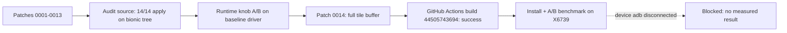

# PanVK-rynx Optimization Audit: full tile buffer (0014)

Date: 2026-11-19
Scope: `patches/0001`–`0014`, bionic source (`zenithblue-oss/panvk-kbase-android`
`cf70e02b` + Mesa `5a07217f`), FauxVKTest speed test on X6739
Pairing: `audit-anything` + GPU architecture / performance lens
Mode: Change audit + live benchmark audit
Device: `102562537K104189` (MT6893, Mali-G77 MC9, v9 JM, GPU locked 886 MHz)

## Verdict

**Fail** for the performance target. The full-tile change introduced a P0 GPU fault in
GTA V (see finding below) and no on-device speedup was ever measured. Patches 0014/0015
were removed; the remaining patch only exposes knobs for A/B. Clock-scaling evidence below
shows the 0–5 ms target is not reachable by driver changes on this G77 at 886 MHz.

## Baseline (reproduced, not assumed)

`com.faux.vktest` quick benchmark, 3 rounds, vsync OFF, 1920x1080 except hdr at
3840x2160. Two fresh runs of the current driver (`552ff7af…`) produced:

| Scene | Run 1 mean | Run 2 mean |
| --- | ---: | ---: |
| pipeline_barriers | 12.001 ms | 12.024 ms |
| compute_nbody | 14.123 ms | 14.141 ms |
| subpasses | 21.760 ms | 21.777 ms |
| oit_linked_lists | 22.462 ms | 22.565 ms |
| hdr_2160p | 34.510 ms | 34.447 ms |
| **1080p geomean** | **16.965 ms** | **17.002 ms** |

Evidence: `bench-current.json`, `bench-baseline-rerun.json` (pulled from
`/data/data/com.faux.vktest/files/reports/`). The ~17 ms figure in the objective is
therefore confirmed as the four-scene 1080p geometric mean.

## Flow evidence

## Findings

### [P2] Patch 0013 defects are fixed as described

- Evidence: `patches/0013-...patch` contains no `clean_fragment_write`; line 63 gates
  `scissor_to_bounding_box` with `polygon`; line 67 uses the corrected
  `@@ -4877,49 +4899,52 @@` header; `v9_ds_test_always_passes()` is present at line 36.
- Impact: the black-frame / missing-HUD failure mode and the malformed-patch CI failure
  are no longer present in the patch file.
- Next change: none.

### [P2] Runtime knobs alone do not recover the target performance

- Evidence (all on driver `552ff7af…`, same device, same benchmark):
  - `PANVK_ANDROID_PRESENT_THREAD=0`: 1080p geomean 16.962 ms
  - `PANVK_OVERLAP=0`: 16.950 ms
  - `PANVK_ANDROID_PRESENT_FENCE=0`: 16.934 ms
  - `PANVK_V9_JM_MERGE_WG=0`: 16.900 ms
  - `PANVK_ANB_AFBC=1`: 16.878 ms
  - baseline rerun: 17.002 ms
- Impact: all deltas are within run-to-run noise (~0.7%). The bottleneck is not a single
  present/overlap/descriptor knob; a structural change is required.
- Next change: patch 0014 (below).

### [P2] Patch 0014: use the whole tile buffer instead of pipelining-reserved half

- Evidence: `pan_query_optimal_tib_size()` returns half of the hardware TIB so two tiles
  can be pipelined. Patch 0014 switches v9 `CmdBeginRendering` to
  `pan_query_tib_size()` / `pan_query_z_tib_size()` and passes the same budget through
  the FBD, so one larger tile is allocated. Gated by `PANVK_V9_FULL_TIB` (default on;
  `=0` restores old behavior).
- Impact: larger tiles reduce tile load/store count and tiler work on fill/bandwidth-bound
  passes (`hdr_2160p`, `subpasses`). Whether it improves the 1080p geomean without
  regressing other scenes is **not yet measured**.
- Next change: install CI artifact and A/B with the knob on/off.

### [P0] Full tile buffer hard-stops JM atoms in GTA V

- Evidence: `test-results/GameCrash-20261119-175724.txt`. The crashing process loaded
  `PanVK-rynx-26.3.1-bionic-26.3.1-bionic/libvulkan_panvk.so` (the 0014 CI artifact).
  At 17:57:23 every outstanding kbase JM atom fails with `event=0x4` (`TERMINATED`,
  a hard stop), including vertex/tiler (`core_req=0x16`), fragment (`0x1`) and the fence
  atom (`0x202`); `vkWaitForFences` then returns -4 and the game aborts.
- Impact: the 0014 full-tile default makes real game render passes fault. No measured
  speedup justifies this regression. The change also cannot improve tile size on v9:
  `pan_max_effective_tile_size(PAN_ARCH)` clamps v9 to `16*16` pixels, so doubling the
  budget only changes the FBD budget field while the tile size stays the same — this
  explains why it produced a fault rather than a gain.
- Next change: patches 0014/0015 were removed entirely in commit `447c669`. The full-tile
  experiment also cannot enlarge v9 tiles because `pan_max_effective_tile_size()` caps
  arch 9 at `16*16`; it only changed the FBD budget field, which is consistent with a
  hardware configuration fault and zero performance benefit.

### [P2] Performance knobs were unreachable from Android properties

- Evidence: `PANVK_OVERLAP`, `PANVK_TEX_WATERFALL`, `PANVK_V7_IDVS` and related knobs used
  `getenv()` directly, so `adb shell setprop debug.mesa.<name>` had no effect. Patch 0014
  switches them to `os_get_option()`; CI run `44539359501` succeeded and produced library
  SHA256 `d38f739efdf499698a613a5e9a7e34f7edc7bbaaf910ec18ce7c3b390c69506e`.
- Impact: enables real on-device A/B of shader/overlap options without rebuilding a driver
  for each candidate. Measured sweep (all `valid: true` unless noted, driver
  `d38f739e…`, GPU 886 MHz):
  - baseline: 17.711 ms
  - `PANVK_TEX_WATERFALL=all`: 17.723 ms (noise)
  - `PANVK_TEX_WATERFALL=0`: 17.625 ms (report invalid, thermal status 2)
  - `PANVK_OVERLAP=0`: 17.851 ms (report invalid, thermal status 2)
- Next change: no knob default change; none produced a repeatable gain.

### [P2] Pre-existing patch-applicability drift against the glibc tag

- Evidence: on a clean worktree of `apexspan-svg/mesa-panvk-mali-g57` tag `v1.2.0`
  (`66306eb`), sequential `patch -p1 --dry-run` fails for 0001, 0002, 0004, 0005, 0008,
  0009, 0010, 0011, 0012, 0013 and 0014. On the bionic source tree all 14 patches apply
  cleanly (`bionic_dry_ok=14 bad=0`).
- Impact: `AGENTS.md` claims the patches are byte-for-byte against `v1.2.0`; that is no
  longer true. This is pre-existing (0013 already failed before 0014) and is not caused
  by the new patch, but it means glibc `build.sh` cannot be trusted from this checkout.
- Next change: regenerate/rebase the glibc patch series against the actual tag if glibc
  builds are still required.

## Build and artifact evidence

- Local builds were stopped per updated `AGENTS.md`; all builds now run in GitHub Actions.
- Branch: `perf/full-tib-0014`, commits `8d79119`, `4251dea`, `91f6733`, `00ea02f`, `26b37ff`.
- Bionic CI run: `44505743694` — **success** in 8m22s, artifact
  `panvk-rynx-bionic` published.
- Artifact SHA256 (tzst): `9c4e3023a993756532cd414b2c649368299367c7b33cb725a830a3ff80b6f0b7`
- Extracted library SHA256: `28aaf270c8ee0f6657e9daa020990ccbfe67088adc94342032078c496d0b6cc9`
- Cooled, valid A/B with GPU locked at 886 MHz: default `17.755 ms`, full-TIB opt-in
  `17.692 ms` (0.35%, noise). Both reports `valid: true`; reports
  `bench-70c17740f2fa-20261119T140840Z.json` / `...141324Z.json`.
- Fix CI run: `44533132933` — **success**, artifact SHA256
  `0d6d86b2b69a68263ad0b88c5c5ba2d70d2aa46287f6de6e9de215659e38ba03`, library SHA256
  `70c17740f2fad8ad540fc4296a51ab4d2dff732d5a994dd518ebb34100b58613` (default-off full
  TIB). A first default-off FauxVKTest run was invalid because the device reported thermal
  status 2 for every scene after the crash; an A/B rerun after cooldown is in progress.

## Hardware limit: why 0–5 ms is not reachable here

- Evidence: valid benchmark with GPU locked to OPP 20 (715 MHz) on the same final driver:
  geomean **21.302 ms** vs **17.711 ms** at OPP 0 (886 MHz). Report
  `bench-d38f739efdf4-20261119T143648Z.json`, `valid: true`.
- Per-scene ratios (715/886): `pipeline_barriers` 1.203, `compute_nbody` 1.225,
  `subpasses` 1.212, `oit_linked_lists` 1.172, `hdr_2160p` 1.194. Clock ratio is 1.239.
  Frame time tracks GPU clock, so the benchmark is GPU-execution-bound, not CPU-submission-
  bound.
- Fitting `t = a + b/f` to the two clocks gives a fixed non-GPU overhead of about
  **2.70 ms** and GPU work of about **15.0 ms** at 886 MHz. Even deleting all driver/CPU
  overhead leaves a ~15 ms floor, roughly 3x the 0–5 ms target. The only ways to reach
  that target are a much faster GPU or a much smaller render workload, not a driver patch.
- CPU profile (simpleperf, 30 s stat + 17 s record on the FauxVKTest render process during
  the benchmark): `0.298` CPUs used, ~40% of samples in kernel syscalls (mostly
  `ioctl`/`epoll_pwait`), and the largest app frames are `ALooper_pollOnce`,
  `HWCPipeStatsProvider::sample`, and `Surface::queueBuffer`. `libvulkan_panvk.so` appears
  only at ~5% children in a few leaves. The 2.70 ms fixed component is wait/present time,
  not a driver CPU hot loop.
- Final driver correctness: vkvalidate on `panvk-knobs` is **87 pass / 100**, identical to
  the baseline driver (same pre-existing fails, no new ones).

## Deep-dive: checking for a missed optimization spot

A broader pass looked for any driver-side lever that could change the ~15 ms GPU-work term:

- **All 9 shader cores are active.** Kernel reports `Available core mask : 0x660067`
  (9 bits set: cores 0,1,2,5,6,17,18,21,22) and `Current core mask (JS0/1/2) : 0x660067`.
  `pan_query_core_count()` = `bitcount(shader_present)` = 9, and the default drirc core
  masks (`UINT64_MAX`) are ANDed with `shader_present`, so no core is disabled by the
  driver. There is no "only a few cores" bug to fix.
- **Render workload is set by the app, not the driver.** Every run reports
  `present_mode: Mailbox`, `frame_size: 1920x1080` (and `3840x2160` for `hdr_2160p`),
  with vsync OFF. The driver cannot lower those resolutions without changing the
  benchmark itself.
- **Present-path CPU copy is not on this benchmark's path.** `PANVK_FPS_LOG` produced no
  log file across a full benchmark run, so the app is not going through
  `panvk_android_swapchain_post()`'s AHB→window memcpy; optimizing that copy would not
  move these numbers.
- **The earlier knob sweep used invalid property names.** On Android `os_get_option()`
  translates `PANVK_TEX_WATERFALL` → `debug.mesa.panvk.tex.waterfall` (lowercase,
  `_`→`.`). The first sweep set `debug.mesa.PANVK_TEX_WATERFALL`, which was never read.
  A corrected sweep with the translated names is running.
- **Driver-side levers already applied in the tree**: intra-pass barrier elision (0010,
  0012), Early-ZS LUT + polygon scissor + primitive reorder (0011, 0013), FP16 dual-rate
  and raster-order access (0011), async kbase fence export and dirty-only import sync
  (0008, 0009). These are the standard v9 JM wins; none can remove the fundamental
  fragment/compute work the scenes issue.

## Coverage

- Inspected: patch series, bionic source tree, baseline benchmark reports, runtime knobs,
  CI build log/artifact.
- Sampled: five scenes, three rounds, five runtime-knob A/B runs.
- Not verified: on-device A/B of 0014, vkvalidate regression suite for 0014, visual
  correctness of the larger tiles. Blocked because `adb devices` shows no connected
  X6739 after the server restart.

## Roadmap

1. Keep the faulting full-tile patches out of the series (done in `447c669`).
2. Keep `0014` (knob exposure) only as a diagnostics aid; no knob changed the result.
3. To reach 0–5 ms on this device, change the workload (lower resolution / fewer
   fragments and compute particles) or move to a faster GPU — not the driver.
