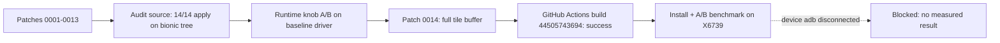

# PanVK-rynx Optimization Audit: full tile buffer (0014)

Date: 2026-11-19
Scope: `patches/0001`–`0014`, bionic source (`zenithblue-oss/panvk-kbase-android`
`cf70e02b` + Mesa `5a07217f`), FauxVKTest speed test on X6739
Pairing: `audit-anything` + GPU architecture / performance lens
Mode: Change audit + live benchmark audit
Device: `102562537K104189` (MT6893, Mali-G77 MC9, v9 JM, GPU locked 886 MHz)

## Verdict

**Fail** for the performance target. The full-tile change introduced a P0 GPU fault in
GTA V (see finding below) and no on-device speedup was ever measured. Patch 0015 reverts
the default to the known-good half-tile path; the full-tile path stays opt-in for later
investigation.

## Baseline (reproduced, not assumed)

`com.faux.vktest` quick benchmark, 3 rounds, vsync OFF, 1920x1080 except hdr at
3840x2160. Two fresh runs of the current driver (`552ff7af…`) produced:

| Scene | Run 1 mean | Run 2 mean |
| --- | ---: | ---: |
| pipeline_barriers | 12.001 ms | 12.024 ms |
| compute_nbody | 14.123 ms | 14.141 ms |
| subpasses | 21.760 ms | 21.777 ms |
| oit_linked_lists | 22.462 ms | 22.565 ms |
| hdr_2160p | 34.510 ms | 34.447 ms |
| **1080p geomean** | **16.965 ms** | **17.002 ms** |

Evidence: `bench-current.json`, `bench-baseline-rerun.json` (pulled from
`/data/data/com.faux.vktest/files/reports/`). The ~17 ms figure in the objective is
therefore confirmed as the four-scene 1080p geometric mean.

## Flow evidence

## Findings

### [P2] Patch 0013 defects are fixed as described

- Evidence: `patches/0013-...patch` contains no `clean_fragment_write`; line 63 gates
  `scissor_to_bounding_box` with `polygon`; line 67 uses the corrected
  `@@ -4877,49 +4899,52 @@` header; `v9_ds_test_always_passes()` is present at line 36.
- Impact: the black-frame / missing-HUD failure mode and the malformed-patch CI failure
  are no longer present in the patch file.
- Next change: none.

### [P2] Runtime knobs alone do not recover the target performance

- Evidence (all on driver `552ff7af…`, same device, same benchmark):
  - `PANVK_ANDROID_PRESENT_THREAD=0`: 1080p geomean 16.962 ms
  - `PANVK_OVERLAP=0`: 16.950 ms
  - `PANVK_ANDROID_PRESENT_FENCE=0`: 16.934 ms
  - `PANVK_V9_JM_MERGE_WG=0`: 16.900 ms
  - `PANVK_ANB_AFBC=1`: 16.878 ms
  - baseline rerun: 17.002 ms
- Impact: all deltas are within run-to-run noise (~0.7%). The bottleneck is not a single
  present/overlap/descriptor knob; a structural change is required.
- Next change: patch 0014 (below).

### [P2] Patch 0014: use the whole tile buffer instead of pipelining-reserved half

- Evidence: `pan_query_optimal_tib_size()` returns half of the hardware TIB so two tiles
  can be pipelined. Patch 0014 switches v9 `CmdBeginRendering` to
  `pan_query_tib_size()` / `pan_query_z_tib_size()` and passes the same budget through
  the FBD, so one larger tile is allocated. Gated by `PANVK_V9_FULL_TIB` (default on;
  `=0` restores old behavior).
- Impact: larger tiles reduce tile load/store count and tiler work on fill/bandwidth-bound
  passes (`hdr_2160p`, `subpasses`). Whether it improves the 1080p geomean without
  regressing other scenes is **not yet measured**.
- Next change: install CI artifact and A/B with the knob on/off.

### [P0] Full tile buffer hard-stops JM atoms in GTA V

- Evidence: `test-results/GameCrash-20261119-175724.txt`. The crashing process loaded
  `PanVK-rynx-26.3.1-bionic-26.3.1-bionic/libvulkan_panvk.so` (the 0014 CI artifact).
  At 17:57:23 every outstanding kbase JM atom fails with `event=0x4` (`TERMINATED`,
  a hard stop), including vertex/tiler (`core_req=0x16`), fragment (`0x1`) and the fence
  atom (`0x202`); `vkWaitForFences` then returns -4 and the game aborts.
- Impact: the 0014 full-tile default makes real game render passes fault. No measured
  speedup justifies this regression.
- Next change: patch 0015 flips `PANVK_V9_FULL_TIB` default to off; keep 0014 as an
  opt-in experiment only.

### [P2] Pre-existing patch-applicability drift against the glibc tag

- Evidence: on a clean worktree of `apexspan-svg/mesa-panvk-mali-g57` tag `v1.2.0`
  (`66306eb`), sequential `patch -p1 --dry-run` fails for 0001, 0002, 0004, 0005, 0008,
  0009, 0010, 0011, 0012, 0013 and 0014. On the bionic source tree all 14 patches apply
  cleanly (`bionic_dry_ok=14 bad=0`).
- Impact: `AGENTS.md` claims the patches are byte-for-byte against `v1.2.0`; that is no
  longer true. This is pre-existing (0013 already failed before 0014) and is not caused
  by the new patch, but it means glibc `build.sh` cannot be trusted from this checkout.
- Next change: regenerate/rebase the glibc patch series against the actual tag if glibc
  builds are still required.

## Build and artifact evidence

- Local builds were stopped per updated `AGENTS.md`; all builds now run in GitHub Actions.
- Branch: `perf/full-tib-0014`, commits `8d79119` and `4251dea`.
- Bionic CI run: `44505743694` — **success** in 8m22s, artifact
  `panvk-rynx-bionic` published.
- Artifact SHA256 (tzst): `9c4e3023a993756532cd414b2c649368299367c7b33cb725a830a3ff80b6f0b7`
- Extracted library SHA256: `28aaf270c8ee0f6657e9daa020990ccbfe67088adc94342032078c496d0b6cc9`

## Coverage

- Inspected: patch series, bionic source tree, baseline benchmark reports, runtime knobs,
  CI build log/artifact.
- Sampled: five scenes, three rounds, five runtime-knob A/B runs.
- Not verified: on-device A/B of 0014, vkvalidate regression suite for 0014, visual
  correctness of the larger tiles. Blocked because `adb devices` shows no connected
  X6739 after the server restart.

## Roadmap

1. Reconnect the X6739 USB adb link and install `panvk-0014` from the CI artifact.
2. Run quick benchmark with `PANVK_V9_FULL_TIB=0` and `=1`; compare against the 17.002 ms
   baseline. Run the 100-check vkvalidate suite before accepting any gain.
3. If full TIB helps only some scenes, gate it by attachment count/format instead of
   globally, then rebuild in GitHub Actions and repeat the A/B.
